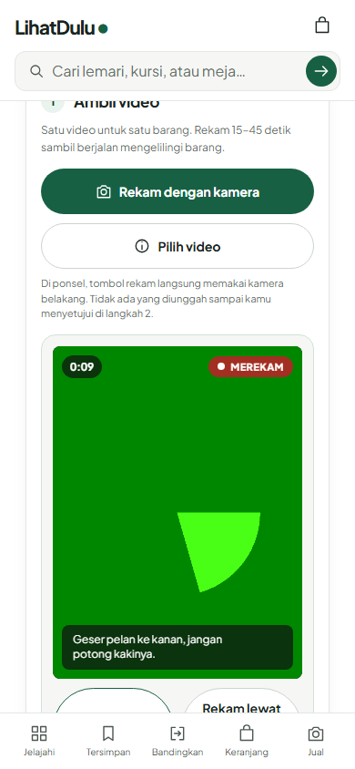
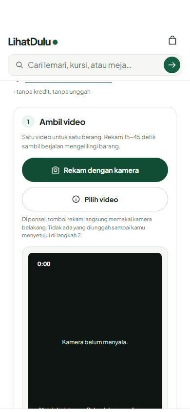
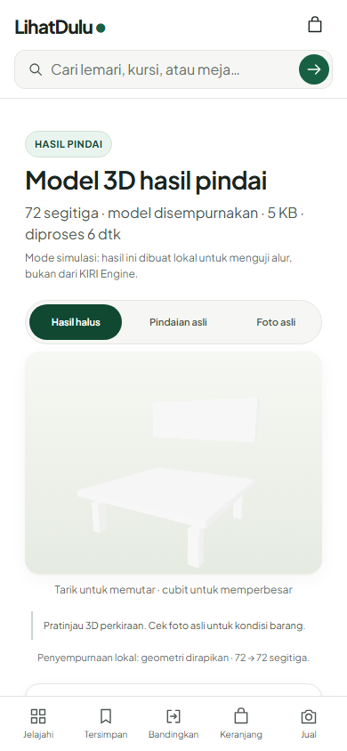

# Competition release log — 2026-11-23

Branch `release/competition-judge`, one integration branch from `origin/main`
(`8b404df`), with `origin/feat/product-refinement` (`0667dcd`) merged once,
`--no-ff`. `origin/feat/kiri-scan` (`5dd1458`) is an ancestor of that branch, so
the KIRI work arrives in this lineage exactly once. The overnight scanner
branches (`work/scan-quality-overnight-20261122-153241`, the evidence branch,
PRs #3 and #5) are a different experiment; they are left untouched and are not
merged here.

## What changed

| Area | Change |
|---|---|
| Integration | KIRI scan backend, refinement stage, raw/refined/photo tabs and the offline chair explorer now live beside the V8 marketplace on one branch. |
| Seller capture | `/jual/pindai` leads with **Rekam dengan kamera** (rear camera, 1920×1080, 6 Mbps). Live timer, six guidance steps, review → **Gunakan rekaman** → retake, plus a native-camera fallback that opens the phone's own recorder. |
| Format reality | Android Chromium records **WebM**, iPhone records MP4. The server sniffs the container, converts WebM/MOV to MP4 with FFmpeg, re-hashes it, deletes the original, and records `source.transcodedFrom`. A browser that reports an unknown duration for a streamed WebM is no longer treated as unreadable. |
| States | Upload, queue, processing, download, conversion, success, failure, expiry and retry each have their own copy and recovery action. Reload resumes the stored job; a repeat upload of the same bytes deduplicates server-side. |
| Poor results | When refinement reports a large hole share, `/pindai/:id` opens on **Foto asli** with a one-line reason and keeps the model one tap away. |
| Saved proof | `public/demo/kursi` is a real finished job (refined GLB, raw GLB, eight stills) served at `/pindai/demo-chair`, reachable from the upload page and the waiting state. No credits, no KIRI call. |
| Routing | `vercel.json` rewrites every non-`/api` path to the app, so `/beli`, `/jual`, `/jual/pindai` and `/pindai/:id` stop 404-ing on the static host. `Dockerfile` + `.dockerignore` describe the same-origin judging host (Node + FFmpeg + job volume). |
| Viewer | Light stage for meshes, dark stage for splats, opening pose that shows the whole object, reset, resize and orbit; tabs keep the chosen view across a reload. |
| Docs | README rewritten around one judging walkthrough, local commands and one scan-host runbook. |

## Before and after (390×844)

| Before — `origin/main` | After — this branch |
|---|---|
|  |  |

The old page opened straight into a dark, dead camera box with no file option and
no statement of what happens to the recording. The new one states the promise,
offers the camera and an existing file as two equal actions, links a real saved
result, and keeps consent and the credit cost visible before anything is sent.

| Recording | Camera denied | Result |
|---|---|---|
|  |  |  |

Recording shows the timer, the stop action and one guidance line at a time.
A refusal explains itself and leaves both recovery routes on screen. The result
page names the source, keeps the photo/model switch one tap away and offers the
next action.

## Verified on this branch

| Check | Command | Result |
|---|---|---|
| Unit suite | `npm run test:unit` | **326 tests, 325 pass, 1 skipped, 0 fail** |
| Marketplace acceptance | `npm run test:browser` | **26 passed, 0 failed** |
| Scan acceptance (mocks) | `node scripts/verify-kiri-scan.mjs` | **33/33 checks**, including a fake-camera recording run, screenshots in `var/kiri-qa` |
| Build | `npm run build` | green (pre-existing chunk-size warning) |
| Deep links on the Node host | `curl` on `127.0.0.1:8795` | `/`, `/beli`, `/jual`, `/jual/pindai`, `/pindai/demo-chair`, `/barang/sora` → **200 text/html** |
| Same-origin LAN host | `KIRI_HOST=0.0.0.0 KIRI_PORT=8797` | deep links 200 from `http://192.168.0.128:8797` (camera needs HTTPS, fallback shown) |
| Camera → job → result (MP4) | `node var/release/tools/camera-flow.mjs` | 10 s recording → 749 KB preview → consent → job → `/pindai/9aab1907-…` → reload resumes → reopen works; tracks released |
| Camera → job → result (WebM) | `FORCE_WEBM=1 node var/release/tools/camera-flow.mjs` | 951 KB WebM → server transcode to 312 KB MP4 (`source.transcodedFrom: "webm"`) → `/pindai/5ab30ee8-…` → reload resumes → reopen works |
| Narrow phone | `node var/release/tools/polish-check.mjs` | 360 px: 0 px horizontal overflow, primary buttons 50×270 |
| Camera denied | same harness, no fake-UI flag | refusal explained in Indonesian; file picker and native-camera fallback both stay visible |
| Desktop keyboard | same harness | 12 tabs to **Rekam dengan kamera**, 3 px solid focus ring |
| Static host without the API | built `dist` served by `vite preview`, no `/api` | page renders, banner says *Server pindai belum bisa dihubungi…*, submit disabled, no page errors; `/pindai/demo-chair` still opens the saved chair |

Screenshot set (local, `var/release/shots`): `before_390_jual_pindai.png`,
`before_1440_jual_pindai.png`, `360_jual_pindai.png`, `390_denied.png`,
`1440_focus_camera.png`, `camera-{1..7}{,-webm}-*.png`.

## Not verified / open gates

1. **The scan host is not deployed.** The public site is
   `https://lihatdulu-sooty.vercel.app`; at the start of this run it returned 200
   on `/` and **404** on `/beli`, `/jual`, `/jual/pindai`, `/barang/sora` and
   `/pindai/:id`. `vercel.json` now rewrites those paths, but Vercel cannot run
   the scan backend (body limit, execution time, no disk), so a judge's own scan
   still needs a Docker-capable host with HTTPS.
2. **No Docker image was built here** — the Docker CLI is installed but the
   daemon is not running in this session. The Dockerfile is unbuilt; the same
   process was verified directly with `KIRI_HOST=0.0.0.0`.
3. **No paid KIRI submission tonight.** The acceptance run is budgeted for the
   intended HTTPS judging URL after deployment, and no such URL exists yet. Last
   observed balance from the previous workstream: **6 credits**. Nothing in this
   session called KIRI.
4. **Physical phone acceptance is pending**: record → preview → submit → refresh
   mid-process → orbit → open original photos → reopen the result URL. Everything
   except the physical device was exercised in Chromium with a fake camera,
   including a forced-WebM run through the real FFmpeg conversion.

## One authorized live test, when a key and a host exist

```bash
docker build -t lihatdulu .
docker run -p 8787:8787 -e KIRI_API_KEY=... -v lihatdulu-jobs:/app/var/kiri lihatdulu
# then open https://<host>/jual/pindai on a phone and record once
```

Expected: the recording is accepted, the job shows upload → queue → processing,
the result opens at `/pindai/:id`, and a refresh resumes the same job. Server
logs carry the serial and timings; the key stays in the environment.

## Judge-path polish and measured performance — 2026-11-25

Same branch, same stack (Vite, plain JS, Three.js, Plus Jakarta Sans, white
surfaces, forest-green accents). Nothing was rebranded; the changes remove
duplicate controls, make the evidence reachable, and keep the 3D payload off the
pages that do not need it.

| Area | Change |
|---|---|
| Home, phone | One search control instead of two (the header field steps aside at ≤900 px), with **Jelajahi katalog** and **Coba Lemari Sora 3D** directly under it. |
| Sora | The media tabs now name the evidence: **Gambar (n)**, **Putar 3D**, **Coba di ruang**, **Kondisi (n)**. On a phone they sit in an even 2×2 grid instead of a row of three plus one full-width tab. |
| Purchase bar | At ≤700 px the fixed bar can no longer cover the 3D toolbar, motion toggles or room actions: the stage reserves its height, and the controls keep a scroll margin. |
| Seller | `/jual` opens with two clearly different paths — **Contoh disiapkan · Panduan video Sora** (no upload, no credits) beside **Pindai baru · Pindai furnitur dari video** (needs the scan host and credits, links the saved chair). |
| Saved chair | `/pindai/demo-chair` shows the original photo directly under the source tabs when **Foto asli** is chosen, keeps the raw and refined models one tap away, and moves provenance and limitations into one short summary plus a collapsed detail list. |
| Source choice | Photos-first on a fresh visit; an explicit tab choice is remembered per result and survives a reload. The tablist keeps focus and supports Arrow/Home/End. |
| Honest copy | The refinement note no longer repeats the summary. Dimensions are labelled as the seller's, not measured. The 18,8 % see-through silhouette and the black mesh chair stay stated. `/tentang` now separates the authored Sora demo, the saved real scan, the simulated commerce and the fact that live scanning needs its own host. |
| Static host | Without `/api/kiri` the upload page states **Demo statis — pindai langsung belum aktif di alamat ini**, disables camera and file submission with an accessible description, and leads with **Buka contoh kursi asli**. |
| Performance | The Spark/SPZ runtime moved to `scan-splat.js` and is imported only when an SPZ opens. A GLB page downloads `scan-viewer` (4.78 kB) instead of the old 2.71 MB bundle. |

### Measured on the same routes and viewport (390×844, `vite preview`, CDP bytes)

| Route | `origin/main` `8b404df` | This branch |
|---|---|---|
| `/` | 453 kB | 454 kB |
| `/beli` | 660 kB | 661 kB |
| `/barang/sora` | 475 kB | 476 kB |
| `/barang/sora?tab=model` | 5 213 kB | 5 214 kB |
| `/barang/sora?tab=room` | 4 896 kB | 4 897 kB |
| `/jual` | 567 kB | **445 kB** |
| `/jual/pindai` | 127 kB | 129 kB |
| `/pindai/demo-chair` (photos) | 1 685 kB | 1 688 kB |
| `/tentang` | 108 kB | 109 kB |

Home, catalogue and the Sora product page still ship **no 3D**: 54 kB of
JavaScript, the same files as before. The ~1 kB deltas are the new copy and CSS.

The saved chair with **Hasil halus** opened (the tab that actually mounts 3D):

| | Before | After |
|---|---|---|
| Total transfer | 4 686 kB | **3 764 kB** (−922 kB, −20 %) |
| JavaScript | 1 161 kB | **238 kB** (−923 kB, −79 %) |
| `scan-splat` requested for a GLB | n/a | **no** (asserted in the suite) |
| Stage ready under SwiftShader | 4 561 ms | 4 358 ms |

The photos (1 606 kB) and the 1 905 kB refined GLB are unchanged; the saving is
the Spark runtime the GLB page no longer parses or downloads.

### Widths checked

`320`, `390`, `768`, `1440`: no page-level horizontal overflow on any route
(`documentElement.scrollWidth` equals the viewport, 310/320 … 1430/1440 with the
scrollbar). The only elements past the right edge are inside the intended
horizontal rails (`gallery-thumb` on the product page, `quick-filter` chips on
the catalogue).

### Verified on this pass

| Check | Command | Result |
|---|---|---|
| Unit suite | `npm run test:unit` | **339 tests, 338 pass, 1 skipped, 0 fail** |
| Marketplace acceptance | `npm run test:browser` | **26 passed, 0 failed** |
| Scan acceptance (mocks) | `npm run test:kiri:browser` | **42/42 checks** |
| Build | `npm run build` | green (pre-existing >500 kB warning) |

A stale or unknown `/pindai/:id` link on the static host used to poll five times
behind a spinner, because `/api/...` is rewritten to the app shell. The result
page now recognises a non-JSON answer as **"Alamat ini hanya menyajikan contoh
tersimpan, tanpa server pindai"**, shows it in 320 ms and offers **Contoh kursi
asli** beside the retake and catalogue links.

New coverage for what the old suite missed: the saved chair opens on photos with
the original photo directly under the tabs, an explicit model choice survives a
reload, keyboard focus stays on the tablist while the source changes, a GLB never
requests `scan-splat`, a slow model keeps the tabs and the 18,8 % limit visible
and the photos one tap away, leaving the page mid-upload cancels the send without
creating a job, and a host without `/api/kiri` shows the static state with the
saved chair.

### Flake seen and handled

The observation harness hit `Page.captureScreenshot: Unable to capture
screenshot` once, at 320 px on `/barang/sora` under SwiftShader; the same
focused run passed immediately afterwards with no page errors, and the scan
suite's own screenshots at that width pass. Separately, the camera check read the
recording facts while the video probe was still running and saw `memuat detail
video…`; it now waits for the recovered length before asserting, which is a test
fix, not an app change.
