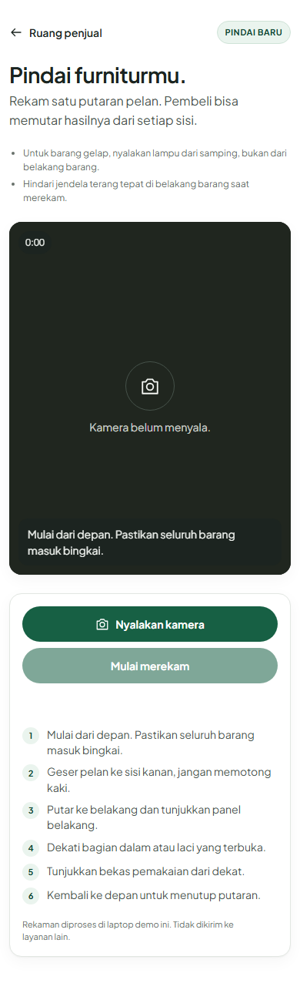
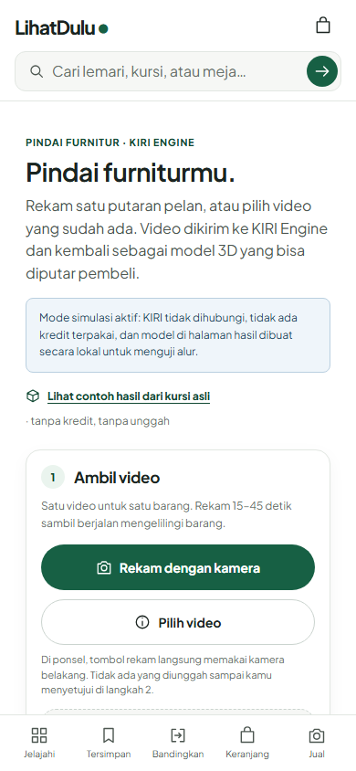

# Competition release log — 2026-11-23

Branch `release/competition-judge`, one integration branch from `origin/main`
(`8b404df`), with `origin/feat/product-refinement` (`0667dcd`) merged once,
`--no-ff`. `origin/feat/kiri-scan` (`5dd1458`) is an ancestor of that branch, so
the KIRI work arrives in this lineage exactly once. The overnight scanner
branches (`work/scan-quality-overnight-20261122-153241`, the evidence branch,
PRs #3 and #5) are a different experiment; they are left untouched and are not
merged here.

## What changed

| Area | Change |
|---|---|
| Integration | KIRI scan backend, refinement stage, raw/refined/photo tabs and the offline chair explorer now live beside the V8 marketplace on one branch. |
| Seller capture | `/jual/pindai` leads with **Rekam dengan kamera** (rear camera, 1920×1080, 6 Mbps). Live timer, six guidance steps, review → **Gunakan rekaman** → retake, plus a native-camera fallback that opens the phone's own recorder. |
| Format reality | Android Chromium records **WebM**, iPhone records MP4. The server sniffs the container, converts WebM/MOV to MP4 with FFmpeg, re-hashes it, deletes the original, and records `source.transcodedFrom`. A browser that reports an unknown duration for a streamed WebM is no longer treated as unreadable. |
| States | Upload, queue, processing, download, conversion, success, failure, expiry and retry each have their own copy and recovery action. Reload resumes the stored job; a repeat upload of the same bytes deduplicates server-side. |
| Poor results | When refinement reports a large hole share, `/pindai/:id` opens on **Foto asli** with a one-line reason and keeps the model one tap away. |
| Saved proof | `public/demo/kursi` is a real finished job (refined GLB, raw GLB, eight stills) served at `/pindai/demo-chair`, reachable from the upload page and the waiting state. No credits, no KIRI call. |
| Routing | `vercel.json` rewrites every non-`/api` path to the app, so `/beli`, `/jual`, `/jual/pindai` and `/pindai/:id` stop 404-ing on the static host. `Dockerfile` + `.dockerignore` describe the same-origin judging host (Node + FFmpeg + job volume). |
| Viewer | Light stage for meshes, dark stage for splats, opening pose that shows the whole object, reset, resize and orbit; tabs keep the chosen view across a reload. |
| Docs | README rewritten around one judging walkthrough, local commands and one scan-host runbook. |

## Before and after (390×844)

| Before — `origin/main` | After — this branch |
|---|---|
|  |  |

The old page opened straight into a dark, dead camera box with no file option and
no statement of what happens to the recording. The new one states the promise,
offers the camera and an existing file as two equal actions, links a real saved
result, and keeps consent and the credit cost visible before anything is sent.

| Recording | Camera denied | Result |
|---|---|---|
|  |  |  |

Recording shows the timer, the stop action and one guidance line at a time.
A refusal explains itself and leaves both recovery routes on screen. The result
page names the source, keeps the photo/model switch one tap away and offers the
next action.

## Verified on this branch

| Check | Command | Result |
|---|---|---|
| Unit suite | `npm run test:unit` | **326 tests, 325 pass, 1 skipped, 0 fail** |
| Marketplace acceptance | `npm run test:browser` | **26 passed, 0 failed** |
| Scan acceptance (mocks) | `node scripts/verify-kiri-scan.mjs` | **33/33 checks**, including a fake-camera recording run, screenshots in `var/kiri-qa` |
| Build | `npm run build` | green (pre-existing chunk-size warning) |
| Deep links on the Node host | `curl` on `127.0.0.1:8795` | `/`, `/beli`, `/jual`, `/jual/pindai`, `/pindai/demo-chair`, `/barang/sora` → **200 text/html** |
| Same-origin LAN host | `KIRI_HOST=0.0.0.0 KIRI_PORT=8797` | deep links 200 from `http://192.168.0.128:8797` (camera needs HTTPS, fallback shown) |
| Camera → job → result (MP4) | `node var/release/tools/camera-flow.mjs` | 10 s recording → 749 KB preview → consent → job → `/pindai/9aab1907-…` → reload resumes → reopen works; tracks released |
| Camera → job → result (WebM) | `FORCE_WEBM=1 node var/release/tools/camera-flow.mjs` | 951 KB WebM → server transcode to 312 KB MP4 (`source.transcodedFrom: "webm"`) → `/pindai/5ab30ee8-…` → reload resumes → reopen works |
| Narrow phone | `node var/release/tools/polish-check.mjs` | 360 px: 0 px horizontal overflow, primary buttons 50×270 |
| Camera denied | same harness, no fake-UI flag | refusal explained in Indonesian; file picker and native-camera fallback both stay visible |
| Desktop keyboard | same harness | 12 tabs to **Rekam dengan kamera**, 3 px solid focus ring |
| Static host without the API | built `dist` served by `vite preview`, no `/api` | page renders, banner says *Server pindai belum bisa dihubungi…*, submit disabled, no page errors; `/pindai/demo-chair` still opens the saved chair |

Screenshot set (local, `var/release/shots`): `before_390_jual_pindai.png`,
`before_1440_jual_pindai.png`, `360_jual_pindai.png`, `390_denied.png`,
`1440_focus_camera.png`, `camera-{1..7}{,-webm}-*.png`.

## Not verified / open gates

1. **The scan host is not deployed.** The public site is
   `https://lihatdulu-sooty.vercel.app`; at the start of this run it returned 200
   on `/` and **404** on `/beli`, `/jual`, `/jual/pindai`, `/barang/sora` and
   `/pindai/:id`. `vercel.json` now rewrites those paths, but Vercel cannot run
   the scan backend (body limit, execution time, no disk), so a judge's own scan
   still needs a Docker-capable host with HTTPS.
2. **No Docker image was built here** — the Docker CLI is installed but the
   daemon is not running in this session. The Dockerfile is unbuilt; the same
   process was verified directly with `KIRI_HOST=0.0.0.0`.
3. **No paid KIRI submission tonight.** The acceptance run is budgeted for the
   intended HTTPS judging URL after deployment, and no such URL exists yet. Last
   observed balance from the previous workstream: **6 credits**. Nothing in this
   session called KIRI.
4. **Physical phone acceptance is pending**: record → preview → submit → refresh
   mid-process → orbit → open original photos → reopen the result URL. Everything
   except the physical device was exercised in Chromium with a fake camera,
   including a forced-WebM run through the real FFmpeg conversion.

## One authorized live test, when a key and a host exist

```bash
docker build -t lihatdulu .
docker run -p 8787:8787 -e KIRI_API_KEY=... -v lihatdulu-jobs:/app/var/kiri lihatdulu
# then open https://<host>/jual/pindai on a phone and record once
```

Expected: the recording is accepted, the job shows upload → queue → processing,
the result opens at `/pindai/:id`, and a refresh resumes the same job. Server
logs carry the serial and timings; the key stays in the environment.
