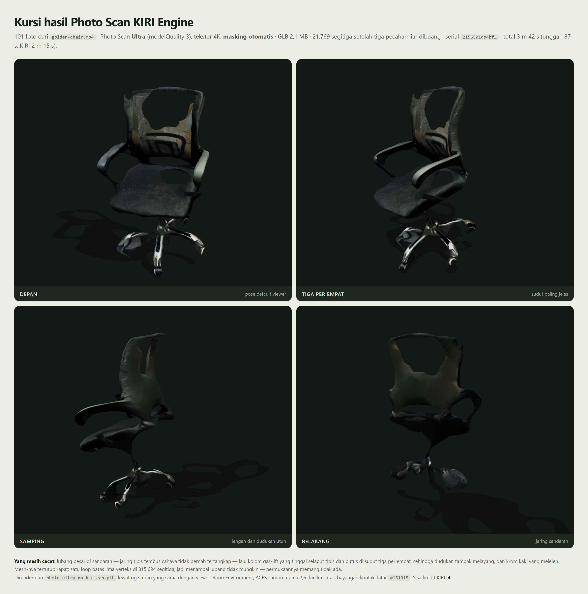
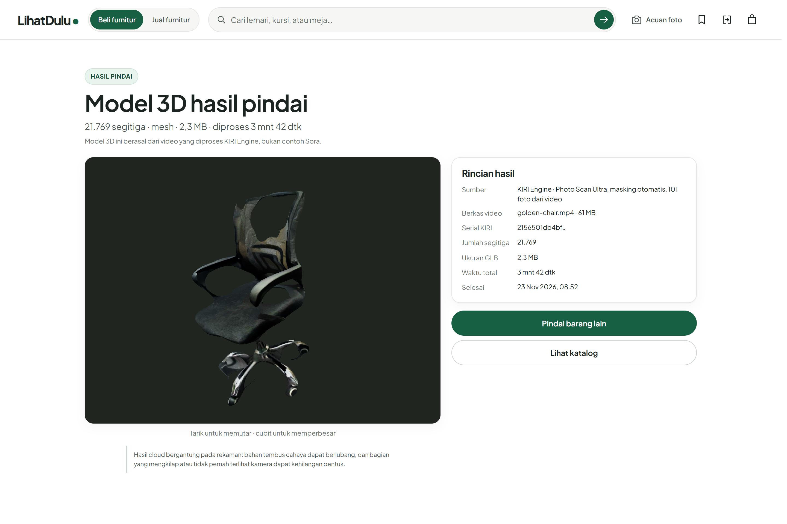
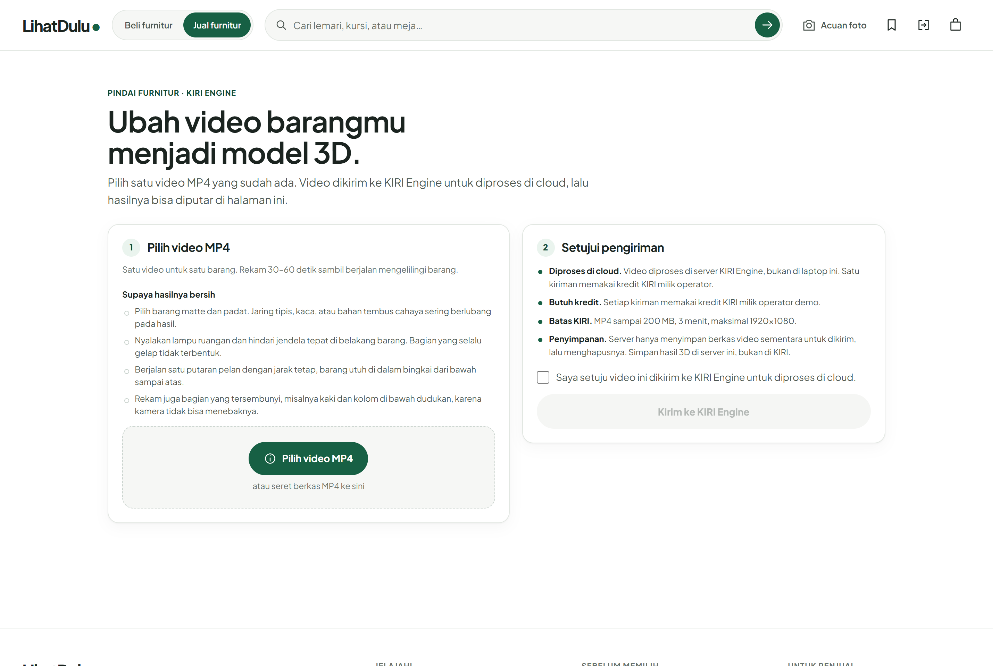

# KIRI-backed scan prototype

**Status:** upload-only prototype, exercised against the real KIRI API over
fourteen jobs and three credits' worth of routes. The pipeline, viewer, reload
resume and mobile layout work. The shipped default is now **KIRI Photo Scan with
object masking on** (`KIRI_INPUT=photo`, `KIRI_MODEL_QUALITY=3` Ultra): it is the
only route that returns the chair alone, in two to four minutes, for one credit.
It is still **not listing-ready** — the backrest has a real hole and the base is
soft — so the honest use is a labelled demo, not a seller-facing promise. Every
route and its measurement is below; the repeat command is at the end.



*The best artefact of fourteen jobs: 101 stills from `golden-chair.mp4`, Photo
Scan Ultra with masking on, 21 769 triangles after shard removal. Front, three
quarter, side and back, rendered from the saved GLB through the same studio rig
the viewer uses. The three defects are visible in every pose — a hole in the
backrest, a gas-lift column reduced to a thin skin, and melted chrome on the
base — and they are why this is labelled a demo, not a listing.*



*PNG of the real result page at 1440×960: `21.769 segitiga · mesh · 2,3 MB ·
diproses 3 m 42 s`, the provenance rows (Photo Scan Ultra, masking on, 101
photos, serial `2156501db4bf…`), the measured caveat under the viewer and the
orbit hint.*



*The upload page at 1440×960. The four rules under the picker are the ones the
failures produced; nothing is uploaded until the consent box is ticked and
**Kirim ke KIRI Engine** is pressed.*

The older featureless-mesh chair stays in
[assets/kiri-mesh-chair.png](assets/kiri-mesh-chair.png) and
[assets/kiri-mesh-viewer.png](assets/kiri-mesh-viewer.png) for provenance: it
read as a chair but came back as a room-scale shell with texture bleed. Photo
Scan with masking is the one that returns the object alone.*

The old local FFmpeg → COLMAP → Brush → CUDA scanner has been removed from the
active tree. It remains documented for provenance in
[scan-toolchain.md](scan-toolchain.md); nothing in the new path calls it.

## Flow

`/jual/pindai`

1. Choose an existing MP4 and preview it locally. Nothing is uploaded while the
   seller is choosing.
2. The page states that the file goes to KIRI Engine for cloud processing, lists
   the four capture rules the trials produced, and requires an explicit consent
   checkbox before **Kirim ke KIRI Engine** works.
3. Upload progress, queue, processing, download/conversion, success and failure
   are shown as separate stages in Indonesian.
4. **Buka hasil 3D** opens `/pindai/:id`, which polls the same job and lazy-loads
   the viewer: SparkJS for an SPZ splat cloud, three.js `GLTFLoader` for a GLB
   mesh (`KIRI_INPUT=mesh`).

Reloading either page resumes the stored job (`localStorage` key
`lihatdulu:kiri-job`) instead of starting a new upload. The server also reuses a
job for the same video bytes (SHA-256), so a double tap cannot submit twice.

## Server

| File | Responsibility |
|---|---|
| `server/kiri-server.mjs` | HTTP routes, raw MP4 upload, static `dist` + SPA fallback, safe logs |
| `server/kiri-service.mjs` | submit → poll with exponential backoff → download → finalize; resume on boot |
| `server/kiri-client.mjs` | the only live KIRI adapter; key stays here |
| `server/kiri-mock.mjs` | labelled simulation; synthetic chair PLY or GLB, no network |
| `server/kiri-jobs.mjs` | one `jobs/<uuid>/job.json` per job, atomic writes, dedupe, prune |
| `server/kiri-artifact.mjs` | PLY property/stride validation, SPZ and GLB validation, pinned conversion |
| `server/zip.mjs` | central-directory reader with CRC and zip-slip checks |
| `server/kiri-config.mjs` | `.env` parsing, modes and limits |
| `server/kiri-errors.mjs` | error codes, Indonesian copy, redaction |

No COLMAP, Brush, CUDA or FFmpeg is needed. The only external process is the
pinned converter already in `node_modules`, invoked with a fixed argument array:

```sh
node node_modules/@playcanvas/splat-transform/bin/cli.mjs result.ply --filter-nan result.spz
```

The browser never sees the key. It talks only to same-origin `/api/kiri/*`.

### Routes

| Method | Path | Purpose |
|---|---|---|
| GET | `/api/kiri/config` | mode, public limits, poll bounds; never the key |
| POST | `/api/kiri/jobs` | raw MP4 body, `x-file-name`, returns a job DTO |
| GET | `/api/kiri/jobs/:id` | current stage, provenance, artifact URL |
| POST | `/api/kiri/jobs/:id/retry` | re-download/convert a retryable failed job; never re-submits |
| GET/HEAD | `/api/kiri/jobs/:id/result.spz` | the stored splat (`application/octet-stream`) |
| GET/HEAD | `/api/kiri/jobs/:id/result.glb` | the stored mesh (`model/gltf-binary`) |

### Job lifecycle

`uploading → submitting → queued → processing → downloading → converting → ready`

or `failed` / `expired`. Polling starts at `KIRI_POLL_MIN_MS` and doubles up to
`KIRI_POLL_MAX_MS`; eight consecutive poll errors fail the job honestly. On
success the server downloads the KIRI ZIP, finds the splat PLY, validates its
header and 14 Gaussian properties, converts it, validates the SPZ magic and splat
count, then keeps only `job.json` and `result.spz`. The uploaded video, ZIP and
PLY are deleted after use. Failed or expired jobs are never reused by dedupe.

### Backdrop removal

KIRI's 3DGS export appends a synthetic backdrop: a shell of splats at one fixed
radius, all with the same opacity and scale, far outside the subject. It dominates
the bounding box, so the viewer framed a grey ball and hid the chair. On success,
`server/kiri-cleanup.mjs` removes that shell before conversion, but only when the
evidence is unambiguous: one radius/opacity bucket, at least 5 % of the file and
200 splats, at least five times the median radius, a tight (±1) radius spread, and
more than half the splats surviving. Anything else is passed through unchanged.
On the real export it removed exactly 50 000 of 281 000 splats in 110 ms
(69.7 MB → 57.3 MB). The removed count is recorded as `cleanup` on the job, and
the ZIP/PLY are deleted whether finalize succeeds or fails.

Sending the file is the slow step, so it does not share the two-minute control
timeout: `KIRI_UPLOAD_TIMEOUT_MS` (15 min) covers the KIRI upload and the same
budget is set as the Node request timeout for the browser's own upload. A 61 MB,
25 s phone clip took longer than two minutes to reach KIRI, which is exactly the
case the shorter timeout used to abort.

## KIRI API contract used

Source of truth: <https://docs.kiriengine.app/>.

- Base `https://api.kiriengine.app/api`, auth `Authorization: Bearer <key>`.
- Submit `POST /v1/open/3dgs/video` (multipart `videoFile`, `isMesh=0`,
  `isMask=1`) → `data.serialize`.
- Splat profile `POST /v1/open/3dgs/image` (multipart `imagesFiles`, 20–300
  stills) → the same serial contract.
- Photo Scan profile `POST /v1/open/photo/image` (multipart `imagesFiles` 20–300,
  `modelQuality`, `textureQuality`, `textureSmoothing`, `isMask`, `fileFormat`)
  → the same serial contract, but the ZIP holds `3DModel.glb`. Quality is
  `modelQuality` 0 High / 1 Medium / 2 Low / 3 Ultra and `textureQuality` 0 4K /
  1 2K / 2 1K / 3 8K; 0 is the best model and a 4K texture, not "off".
- Mesh profile `POST /v1/open/featureless/image` (multipart `imagesFiles` plus
  `fileFormat=GLB`) → the same serial contract, but the ZIP holds `3DModel.glb`
  and `cameras.json` instead of splats. This is the route that produced a chair.
- Status `GET /v1/open/model/getStatus?serialize=` → `-1` uploading, `0`
  processing, `1` failed, `2` successful, `3` queuing, `4` expired.
- ZIP `GET /v1/open/model/getModelZip?serialize=` → `data.modelUrl`, valid for
  60 minutes. KIRI retains assets for three days.
- Limits enforced in the browser: MP4 up to 200 MB, 3 minutes, 1920×1080. The
  server repeats the type/size checks and never probes with FFmpeg.

## Configuration

Copy `.env.example` to `.env` and fill the key locally. `.env` is git-ignored.

| Variable | Default | Notes |
|---|---|---|
| `KIRI_API_KEY` | — | required for live mode; never logged or served |
| `KIRI_MOCK` | off | `1` runs the labelled simulation, ignores the key |
| `KIRI_API_BASE` | `https://api.kiriengine.app/api` | override only for a proxy |
| `KIRI_JOBS_ROOT` | `var/kiri` | keep job data outside `public/` |
| `KIRI_PORT` / `KIRI_HOST` | `8787` / `127.0.0.1` | |
| `KIRI_SERVE_DIST` | on | serve the built site and SPA routes |
| `KIRI_POLL_MIN_MS` / `KIRI_POLL_MAX_MS` | 5000 / 30000 | backoff bounds |
| `KIRI_KEEP_JOBS` | 50 | terminal jobs kept; active jobs are never pruned |
| `KIRI_MAX_*_BYTES`, `KIRI_MAX_SPLATS` | see `kiri-config.mjs` | hard caps |
| `KIRI_UPLOAD_TIMEOUT_MS` | 900000 | budget for sending the clip to KIRI |
| `KIRI_INPUT` | `photo` | `photo` (Photo Scan mesh, mask on), `mesh` (featureless mesh), `splat` (stills to 3DGS), `video` (3DGS video); unknown values fall back to `photo` |
| `KIRI_FRAME_FPS` / `KIRI_PHOTO_COUNT` | 4 / 120 | stills sampled for `photo`, `mesh` and `splat`; needs `ffmpeg`, falls back to video |
| `KIRI_MODEL_QUALITY` | 3 | Photo Scan only: 3 Ultra, 0 High, 1 Medium, 2 Low |
| `KIRI_TEXTURE_QUALITY` | 0 | Photo Scan only: 0 4K, 1 2K, 2 1K, 3 8K |
| `KIRI_TEXTURE_SMOOTHING` | off | Photo Scan only; KIRI recommends off for precise scans |
| `KIRI_MAX_MODEL_BYTES` | 240 MB | ceiling for a served GLB (the chair is 85 MB) |
| `KIRI_MOCK_FAIL` | — | `submit`, `process` or `zip`, for the harness only |
| `KIRI_MOCK_FAIL_ONCE` | off | fail once, then succeed |

There is no `KIRI_MODE` switch: mock wins when set, live when a key exists,
otherwise `unconfigured` (upload answered with 503 `missing_key`, UI explains).

## Commands

```sh
npm ci
npm run build              # dist is tracked and served by scan:serve
npm run test:unit          # 253 pass / 0 fail
npm run test:kiri          # 118 tests, mock adapter, HTTP boundary and cleanup
npm run test:browser       # 26/26 existing marketplace acceptance
npm run test:kiri:browser  # 20/20 mock browser checks, screenshots in var/kiri-qa
npm run scan:mock          # http://127.0.0.1:8787/jual/pindai
npm run scan:serve         # live if KIRI_API_KEY is set
node scripts/lihatdulu-doctor.mjs --scan
```

The browser harness starts its own server on a free port with a fresh jobs root,
uses the real built `dist`, the real ZIP/PLY/SPZ validation and the real
converter. It checks consent, preview, stages, viewer and orbit, reload resume,
upload-page restore, no camera calls, failure + resend after a server restart,
390×844 layout and touch orbit, the marketplace/catalogue/3D routes, the Sora
routes, unknown IDs, and zero page errors or external requests. Screenshots and
`report.json` are written to `var/kiri-qa/` (git-ignored).

## The first live run (22 November 2026)

One credit was spent on `golden-chair.mp4`, the 25.3 s, 61 MB portrait chair clip
kept from the earlier study (stored 1920×1080 with rotation metadata, so it plays
1080×1920). LihatDulu job `bb2ea77d-6021-4bfb-ab40-88cf9029abb6`, KIRI serial
`7b761bd9d9de4a85ba0494ee5c9f0b2a`.

| Step | Time |
|---|---|
| Browser → our server (local copy) | 0.45 s |
| Server → KIRI upload | 282 s |
| KIRI queue + processing | ~29 min |
| ZIP download, PLY validation, cleanup, SPZ conversion | 233 s |
| Submit → **ready** | 2 274 s (37 min 54 s) |

Result: 281 000 splats, 4 841 973 B SPZ. KIRI read the clip correctly (300 input
frames, portrait 1040×1854 in `cameras.json`). All nine live checks passed: live
server, consent gate, local preview, one submit with a stored serial, polling to
ready, result render, drag orbit, reload resume with no second job, and 390×844
with touch orbit. Evidence is in git-ignored `var/kiri-live/` (`report.json`,
`final-job.json`, 44 screenshots).

**Quality verdict: fails the visual gate.** Before cleanup the viewer showed a
grey ball, because the export carried 50 000 splats at radius exactly 50.0 with
identical opacity and scale. With those stripped, the remaining 231 000 splats
form a dark, hollow shell at radius 3–8 with no recognizable seat, backrest or
legs (`var/kiri-live/shots/core-desktop-viewer.png` and
`clean-desktop-viewer.png`). The adapter, storage, conversion and viewer are
proven; the reconstruction itself is not usable for a listing yet.

Defects the live run exposed, each fixed with a test:

- portrait clips were rejected: the dimension check compared width and height
  with 1920×1080 instead of long edge ≤1920, short edge ≤1080;
- the two-minute control timeout aborted the upload: `KIRI_UPLOAD_TIMEOUT_MS`
  (default 15 min) now covers submit and is also the Node request timeout;
- the real API answers `{code: 200}` for success, which the client treated as an
  error;
- the ZIP and PLY were kept after success (about 120 MB per job) and KIRI's
  backdrop was left in the model — both handled in `finalize`.

Attempts 1–3 are kept under `var/kiri-live/attempts/`. Attempt 3 uploaded the
clip but the `code: 200` bug rejected the answer and the serial was never stored;
KIRI has no list endpoint, so that paid job cannot be recovered from here.

## The overnight quality matrix (22–23 November 2026)

The owner authorised a capped overnight matrix: one GPU lease, serial renders.
Fourteen submissions were made in total; six of them on the current key, which
has **four credits left**. The pipeline held up on every job; the reconstruction
mostly did not.

| # | Input | Mask | KIRI serial | Splats | Max extent | Render |
|---|---|---|---|---|---|---|
| 1 | `golden.mp4` (25 s) | off | lost to a runner bug | — | — | orphaned, unrecoverable |
| 2 | `repeat.mp4` (20 s) | off | `093fabdefb2e4b5db8ae10df5e574eca` | 542 372 | 10.54 m | room soup |
| 3 | 4K take, downscaled | off | `91733bdb660841b3bb90355ddceac229` | 463 764 | 9.77 m | room soup |
| 4 | `t15` take | off | `070ec2f5216d477484a633baf3c98779` | 585 125 | 9.50 m | room soup |
| 5 | 101 stills from `golden` | on | `0d884d60ba4d4c578a9fa22bb83dea87` | 212 144 | 4.58 m | melted chair blob |
| 6 | 101 stills from `golden` | off | `08929a636d77431c9ec5fab3c287622c` | 681 844 | 10.97 m | coloured room smear |
| 7 | 101 stills, featureless mesh | on | `b3217f601ab1485591c33bbea6951f3c` | GLB, 815 094 triangles | 5.65 m | **usable chair** |
| 8 | `golden.mp4` (25 s), 3DGS video | on | `bbaaa972f6fd4493a15933ea700080c8` | 283 745 | 10.51 m | room, not the chair |

Measured, on the same machine and lease: video jobs took 24–27 min from submit
to ready; stills jobs 13–21 min, of which ~93 s was the 101-image upload and
10–11 min KIRI processing. A 154 MB result ZIP took about six minutes to
download. The render harness itself failed twice on the 681 844-splat job: the
real viewer needs more than 120 s to reach `data-state="ready"` under
SwiftShader, so treat large exports as slow on software WebGL, not broken.

Every render was taken with the same five poses through the real viewer and the
same real conversion path, so the sheets compare like with like:
`var/kiri-overnight/20261122-EVIDENCE.jpg` (input frame, four video results, two
stills results, four subject-crop radii).

### The mesh route is the one that worked

The seventh job asked for the documented textureless-object path instead of
splats: 101 stills sampled from the same golden clip, `fileFormat=GLB`. It
returned 36 min later as a 30.6 MB ZIP holding `3DModel.glb` (89 582 948 B,
815 094 triangles, 2 444 663 vertices, one JPEG texture) and `cameras.json`.

Rendered through the real viewer at matched poses it is a chair: backrest with
mesh texture, both arms, seat, gas lift and a five-star base with casters
(`docs/handoff/assets/kiri-mesh-chair.png`). It is a room-scale shell — 3.18 ×
5.65 × 5.52 m — so the viewer frames the whole box and the walls appear at the
front and back; the model is an open shell, so the viewer must force
`THREE.DoubleSide` or the front faces vanish. Those two facts are the reason the
GLB branch exists rather than reusing the splat camera maths untouched.

**Verdict on the splat routes: still failing, and not because of the adapter.** The input frames are
sharp and the chair fills 60–70 % of them
(`var/kiri-overnight/scratch/frames-golden-sheet.jpg`), so framing and lighting
are not the defect. KIRI turns a black mesh chair with glossy chrome into a
low-opacity shell that has the chair's outline but none of its parts: the arms
melt into the seat, the back frame closes into a slab, and the wheel base is
absent. Automatic masking concentrates the model (extent 4.58 m against 10–11 m
without it) but also makes it diverge, producing the melted blob.

### Masking does not isolate a video capture

Job 8 was the last splat hope: the same 25 s golden clip, but sent as 3DGS video
with `isMask=1`, so KIRI would cut the subject out before training. It finished in
30 min 9 s and delivered 54.1 MB of ZIP / 70.4 MB of PLY holding 283 745 splats.
The backdrop shell was there again — 50 000 splats at exactly radius 50.0, removed
by `stripBackdrop` in 182 ms — and what remained measured **10.51 × 5.39 × 7.01 m**:
the room, at the same scale as the unmasked runs. Only 56 % of the remaining
splats lie within 1.4 m of the camera-axis centre, and cropping to that sphere
leaves a blob with no chair in it (`var/kiri-overnight/scratch/gs-r14/shots`).
Masking a video does not narrow the reconstruction; masking *stills* for Photo
Scan does. That is the measured reason the mesh routes are the only ones in scope.

### Why the subject crop is not the answer

`KIRI_CROP=subject` intersects the camera axes from `cameras.json` and cuts a
sphere around that point, which is the right idea for a room-scale export. On
these four captures it cannot work, for a measurable reason: the stored camera
poses do not agree with each other. For each capture, every axis of every stored
rotation was scored against the direction from that camera to the ring centroid;
the best convention (third column, positive) still misses by 45–55° on average.
The rays therefore meet 2–4 m from the subject, and the crop frames a blob
(`var/kiri-overnight/scratch/p01sweep`, `p03sweep`). The profile stays off by
default and is documented as a framing experiment, not a quality fix.

### Photo Scan: the route that returns the chair alone

`POST /v1/open/photo/image` is photogrammetry, not a radiance field. It costs one
credit, finishes in two to four minutes instead of half an hour, and returns
`3DModel.glb` — a surface with one baked texture, small enough to serve directly.
Three jobs were run from the same 239-frame source at Ultra (`modelQuality=3`)
with a 4K texture (`textureQuality=0`) and smoothing off:

| Job | Stills | Mask | KIRI serial | GLB | Upload | KIRI | Total |
|---|---|---|---|---|---|---|---|
| `photo-ultra-nomask` | 101 | off | `52dd5895518042fe99036b4de0e7d1ae` | 7 428 300 B | 84 s | 1 m 57 s | 3 m 21 s |
| `photo-ultra-mask` | 101 | on | `2156501db4bf49ca9de872f929188431` | 2 136 020 B | 87 s | 2 m 15 s | 3 m 42 s |
| `photo-ultra-mask240` | 239 | on | `bbfc0e3167af4d8a966e944605a0efab` | 2 354 868 B | 144 s | 3 m 47 s | 6 m 11 s |

**The mask is the whole difference.** With `isMask=0` the delivery is 7.4 MB of
room — wall, floor, a plant, part of a desk — with the chair half-buried in it,
which is the same failure the video routes have. With `isMask=1` the model is
just the chair on an empty ground plane, 2.1 MB, and the viewer's default frame
lands on the seat. That is the first time the pipeline needed no crop, no
cleanup heuristic and no `KIRI_CROP` experiment to show a chair.

**Where it still fails.** The backrest has a hole. It is a real absence of
surface, not a texture or shading artifact: rendered with `MeshNormalMaterial`
against a magenta background (`var/kiri-overnight/mesh-shots/norm-az0.png`) the
silhouette closes cleanly around the gap. The mesh is also topologically closed —
one boundary loop of five vertices in the whole 101-still GLB — so KIRI welds the
front and back sheets at the rim and the missing patch has no boundary edge to
fill. Cheap hole-filling therefore cannot repair it; the geometry simply is not
there. The base is the second defect: glossy black chrome turns into melted
blobs, and the casters lose their shape. The 239-still run improves the casters
and the seat edge but gives a *larger* void, plus three floating shards (the
biggest 354 triangles across 0.138 m). `mesh-clean.mjs` drops the shards
(`photo-ultra-mask-clean.glb`, 21 769 triangles) and the void stays.

Verdict for the mesh routes: the photo chair is the most legible result of the
whole matrix — arms, seat, gas lift and a five-star base all read correctly — but
a hole in the backrest is not something a seller can put on a listing. It is the
shipped default because it is the best route available behind one credit, and the
result page carries that measured caveat under the viewer instead of a claim of
perfection: translucent material can end up with a hole, and glossy or never-seen
parts can lose their shape.

### The last three attempts, and why they did not rescue it

After the photo chair became the best artefact, three more credits went to the
two obvious repair ideas. All three failed, and each failure is measured:

| Attempt | Change | KIRI serial | Result |
|---|---|---|---|
| `repeat.mp4` photo | different clip, 140 sharp frames, Ultra, 4K, mask on | `d5885fa51cc54313a89d8ca9199f0d29` | GLB 6 883 568 B, 87 657 triangles, 1.76 × 1.47 × 1.04 m — renders as a textured bubble *enclosing* the chair (`var/kiri-overnight/mesh-shots/rep-az35.png`) |
| `golden` sharp subset | 177 frames at Laplacian variance ≥ 350 instead of 101 evenly spaced | `6075642474d6425783b60edc0ee39b58` | GLB 2 526 392 B — backrest inflates into a blob, worse than the original (`mesh-shots/sharp-az35.png`) |
| `t10.mp4` end-to-end | the real server, real upload path, default profile | `436ff32aabb14f488add336b16600497` | GLB 1 531 960 B, 21 670 triangles, melted blob (`var/kiri-overnight/live-photo/shots/`) |

The sharp-frame ranking is real work and kept: `var/kiri-overnight/scratch/rank-sharp.mjs`
computes Laplacian variance through a Playwright canvas (golden p50 453, repeat
p50 577). It just does not help, because sharpness was never the limiting factor.

**Root cause, measured.** The backrest is a translucent knit net. The photo mesh
is topologically closed — a single five-vertex boundary loop in 815 094 triangles
— so no hole-filling can find the missing patch: the surface is genuinely absent,
and the sheet is too thin and too see-through for photogrammetry to land on it.
3DGS is the only representation that could carry it, and KIRI returns 3DGS as the
whole room (`### Masking does not isolate a video capture`). So the defect is a
capture-and-representation limit, not a pipeline bug: a matte, solid object would
not have it, and a see-through one cannot be fixed downstream.

That is why `/jual/pindai` now states the four capture rules the failures
produced, before a credit is spent: matte and solid, even room light with no
window behind, one slow constant-distance orbit, and record the undersides.

## Repeating the live test

Each run spends **one credit**. The shipped default is Photo Scan with masking
on and Ultra geometry, so the plain command is the one to use:

```sh
cd C:/Users/fauzi/OneDrive/Documents/GitHub/Lihatdulu-kiri-scan
printf 'KIRI_API_KEY=%s
' 'PASTE_KEY_HERE' > .env
npm run build
KIRI_MOCK=0 npm run scan:serve
```

Use a different clip, or the ready job is reused by the hash dedupe instead of
submitting. Photo Scan needs `ffmpeg` on `PATH` to sample the stills; without it
the job falls back to the raw video upload and you get room-scale splats. To see
the older routes add `KIRI_INPUT=mesh` (featureless mesh) or `KIRI_INPUT=video`
(3DGS), knowing both fail on a see-through backrest.

Open `http://127.0.0.1:8787/jual/pindai`, choose one MP4, confirm the cloud
notice, and wait for **Siap dilihat**. Then open `/pindai/:id` and drag to orbit.
Remove `.env` afterwards. Do not commit the key, the video, `var/kiri`, or any
downloaded ZIP/PLY.

## Not in scope yet

- In-browser camera capture (deferred until one real clip passes end-to-end).
- Turning a scan into a catalogue listing, accounts, multi-user ownership.
- Queueing across processes; one server process owns the pollers.
- ZIP64 and encrypted KIRI archives (refused with a clear error, not guessed).
- Backups: `var/kiri` is local and git-ignored.
