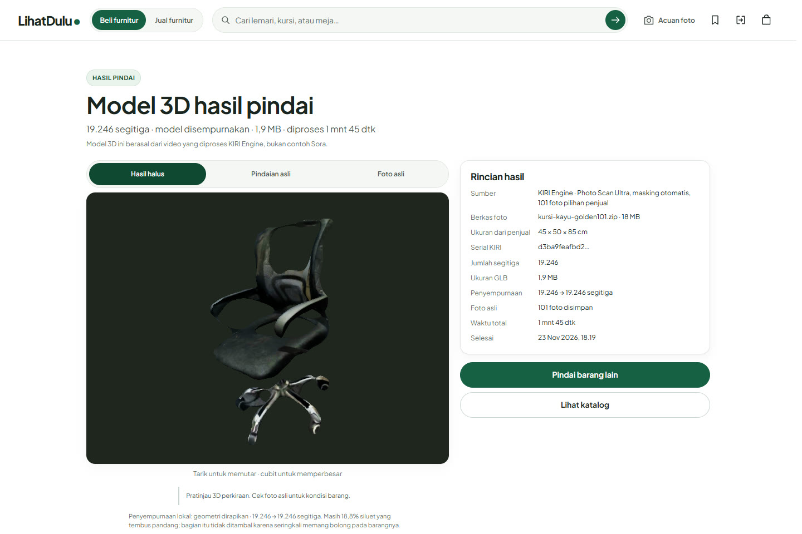
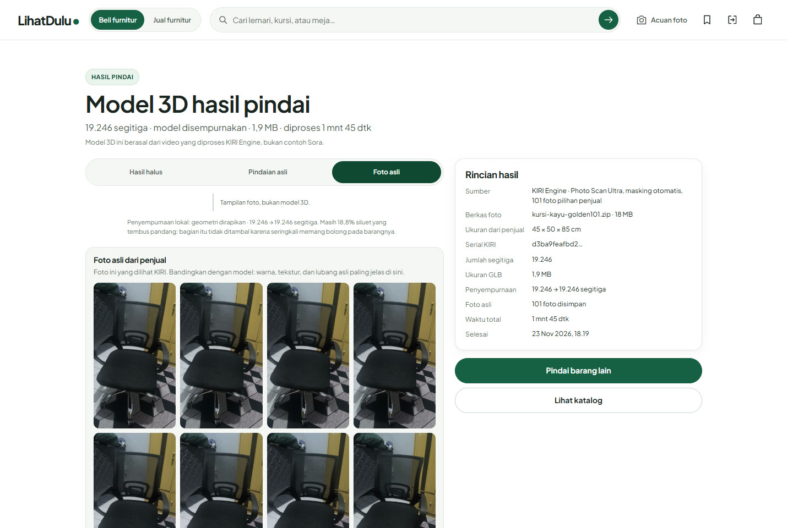
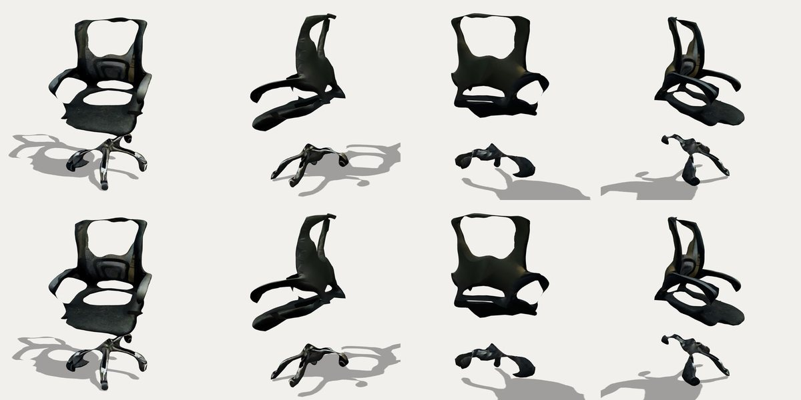
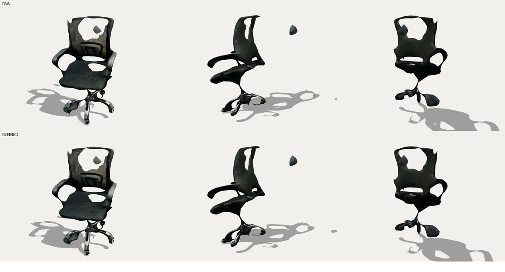
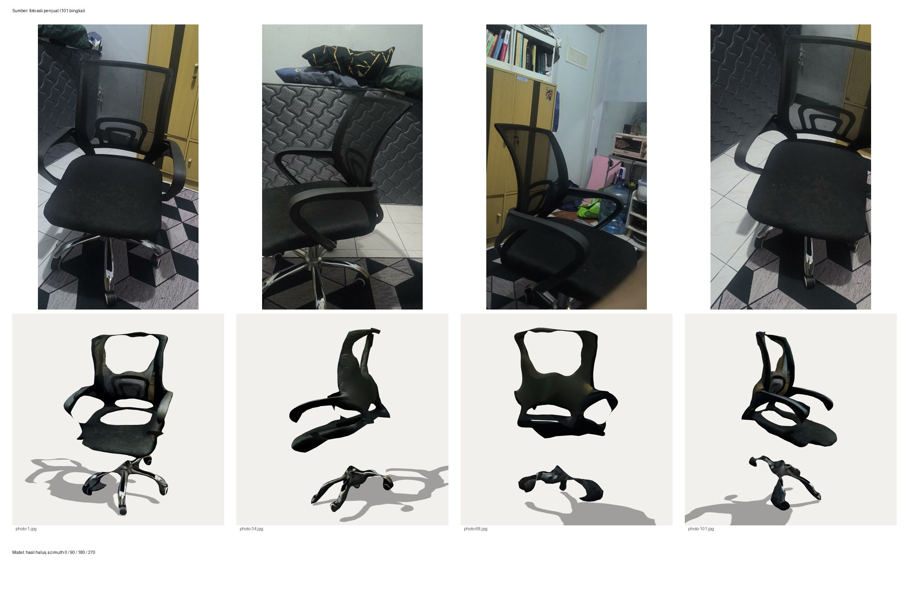

# Product refinement: from a KIRI scan to a preview a buyer can use

**Status:** the shared pipeline runs on any GLB KIRI returns, and it is honest
about what it cannot fix. A live Photo Scan of the chair (job `a0630d0e`,
serial `d3ba9fea…`, 101 stills, Ultra, masking on) finished in **1 m 45 s**,
produced a 1 932 024 B / 19 246-triangle mesh, and the refinement stage ran in
**302 ms**. On that capture refinement found nothing safe to change: the four
see-through holes in the seat and backrest are **topological tunnels in a
closed surface**, not boundary loops, so there is no gap to fill and no shard to
drop. The buyer therefore gets the raw scan, labelled as an estimate, with the
original stills one tab away. The earlier 101-still capture from the same route
and settings *did* have a repairable defect, and there the stage measurably
helped (numbers below).



*The live page for job `a0630d0e`: three sources (Hasil halus / Pindaian asli /
Foto asli), the seller's own 45 × 50 × 85 cm, KIRI's serial, the measured
triangle count, the estimate caveat under the viewer and the line that admits
what the mesh cannot show — “Masih 18,8% siluet yang tembus pandang”.*



*Foto asli: the 101 stills that shaped the mesh, kept from the paid job and
served from storage LihatDulu controls, so the photos stay reachable when the
model is not convincing.*



*Same capture, same four azimuths, raw on top and refined below. The stages agree
on geometry — refinement re-framed and re-shaded this one and left the four
through-holes alone, because they are tunnels, not gaps.*



*The earlier 101-still capture: the floating shard at the left shoulder is gone
and the shading is smoother, with the backrest opening still open.*

Two artefacts, two verdicts:

| capture | raw | refined | verdict |
|---|---|---|---|
| chair, earlier 101-still Photo Scan (`photo-ultra-mask.glb`) | 22 123 tris, one 354-triangle floating shard at 10.8 % of the model diagonal | 21 769 tris, shard dropped, crease-aware normals | **improved** (`refine.status: applied`) |
| chair, live 2026-11-23 job `a0630d0e` | 19 246 tris, four through-holes | 19 246 tris, identical geometry, re-framed and re-normalled | **unchanged, disclosed** (`applied`, `verdict` not clean) |

## What the stage does, in order

`server/kiri-refine.mjs`, pure Node, no dependencies, deterministic:

1. Parse the GLB, weld coincident vertices, measure the mesh.
2. Drop connected components that are both tiny (< 3 % of the largest
   component's triangles) **and** small (< 15 % of the model diagonal). The
   354-triangle shard above had to fail both tests to be dropped; a real shelf
   or handle never fails both.
3. Walk boundary loops and close only the ones that are small (loop span /
   model span ≤ 2 %), short (≤ 48 vertices), and safe (surrounding normals
   within 70°). A real opening — a handle, a shelf, a mesh back — is larger or
   unsupported, so it stays open. Measured on the earlier chair: **3 926 raw
   loops collapse to one 5-vertex welded loop** (97.5 % of them are the two
   halves of a duplicated seam, each edge used twice, hence not a boundary at
   all); that one loop is 3.8 % of the diagonal and is reported as an opening,
   not filled.
4. Recompute normals with a 40° crease so flat panels stay flat and curved
   shells smooth. Measured on the earlier chair: mean normal-vs-face angle
   **8.87° → 6.23°**, corners worse than 45° **2.83 % → 0.10 %**, worst
   **179.2° → 77.4°**.
5. Centre the model and scale its longest side to 1.0 so the viewer frames any
   product the same way. Scale is recorded (`scale: 1.119` on the earlier chair,
   `1.137` on the live one); it is a viewer framing step, never a size claim —
   dimensions come from the seller's own measurements.
6. Write a sibling GLB. The raw file is never overwritten: `/raw.glb` serves
   KIRI's bytes, `/result.glb` serves the refined bytes, and each carries its
   own `x-scan-artifact` header.

## What it refuses to do

- **No membrane fill.** A missing backrest panel is not bridged. Photo-guided
  completion was prototyped from `cameras.json` and the source stills and it was
  **rejected on measurement**: the best visual hull scored silhouette IoU
  **0.026** against the photos, versus **0.144** for the unrepaired scan, covered
  **0 %** of the scan's surface, and invented a solid slab where the chair is a
  shell. The masks it needs cannot be derived from this capture (the knit
  backrest is translucent over a bright wardrobe, so every threshold that drops
  the background also drops the mesh). Details:
  `var/refine-lab/completion-report.md`.
- **No invention of wear or parts.** The stage only removes, closes and
  re-shades. It never adds a part that the scan did not have.
- **No dimensions from the mesh.** Length, width and height in the UI come from
  the seller's `X-Dimensions` header and are labelled as theirs.

## The same four looks, source photo above and refined mesh below



*Top: four of the 101 stills that were actually submitted. Bottom: the refined
mesh at azimuth 0/90/180/270, same order. What survives the pipeline: part count,
both arm arches, the five-star base with casters, the seat-to-back proportion,
and the backrest's own cut-out pattern. What does not: the knit backrest reads as
a lattice of holes rather than a woven surface, the gas lift under the seat was
never reconstructed (the base therefore floats), and the texture is darker than
the photo. Those three are capture-caused. The pipeline measures the first
(18.8 % see-through), cannot invent the second without inventing parts, and does
not touch colour, so the page states the estimate and keeps the photos one tab
away instead of pretending.*

## Does the preview see through itself? Coverage, measured on three axes

`boundaryLoops` cannot answer that question. On the live chair it reports **0**
because the shell is closed (`boundaryEdges 0`, `nonManifoldEdges 0`,
`watertight true`) while four real openings pass straight through it. So the
refiner also voxelises the surface (128 cells on the longest side, `grid`
clamped 8…512) and projects it along x, y and z: a projected pixel counts as a
**hole** when its whole depth column holds no occupied cell. `largestHolePixels`
is the biggest 4-connected hole region.

| file | bytes | x | y | z | max | verdict |
|---|---|---|---|---|---|---|
| `chair-raw.glb` | 1,932,024 | 0.030970 (107/3455, largest 88) | **0.187566** (1059/5646, largest **843**) | 0.030811 (125/4057, largest 59) | 0.187566 | `berlubang` |
| `chair-refined.glb` | 1,950,948 | identical | identical | identical | 0.187566 | `berlubang` |

Same 19,246 triangles, 19.246 → 19.246, so the stage did not invent a membrane:
the four openings are still open, which is correct — they are part of the chair.
Cost of the measurement: 19–36 ms warm on this file, included in the 410 ms cold
refine. Coverage is **report-only** and never gates filling.

The verdict is a contract, not decoration. `metrics.coverage.verdict` is
`"bersih"` when no more than 2 % of the silhouette sees through (`holeBudget`),
`"berlubang"` otherwise, and the page reads it:

> Penyempurnaan lokal: geometri dirapikan · 19.246 → 19.246 segitiga. Masih 18,8%
> siluet yang tembus pandang; bagian itu tidak ditambal karena seringkali memang
> bolong pada barangnya.

That retires the earlier over-claim (“geometri dirapikan” alone implied a closed
surface). Three files, one sentence, all measured: `refineSummary` carries
`coverage { verdict, holeRatioBefore, holeRatioAfter, worstAxis }`,
`refineNote()` reads it, `holeShare()` formats 0.187566 as `18,8%`.

One ordering bug fell out of this: the job was published as `stage: "ready"`
before refinement ran, so a poller could catch `ready` with raw `bytes` and then
fetch the refined file. The artifact is now recorded first, refinement runs, and
only then is `ready` published (plus `finalizeMs`), so a page that renders
`ready` is rendering the final state. `x-scan-artifact` now labels the bytes —
`raw` for an unrefined `/result.glb` — instead of the route.

## The buyer's three sources

`/pindai/:id` offers, best first:

1. **Pratinjau halus** (`/result.glb`) — the refined mesh.
2. **Pindai asli** (`/raw.glb`) — KIRI's untouched export.
3. **Foto asli** (`/photos/:n`) — the stills that shaped the mesh (up to
   `KIRI_KEPT_STILLS`, default 8, evenly spaced across the orbit).

Whichever model is shown, the caveat reads
**“Pratinjau 3D perkiraan. Cek foto asli untuk kondisi barang.”** When refinement
fails, the page falls back to the raw scan, says so, and offers a **retry**
that re-runs the stage from the saved GLB — it cannot spend a credit.

## Failure classes seen live, with the numbers

| input | job | result |
|---|---|---|
| 24 synthetic orbit renders of `cabinet.glb`, masking on | `b9d350ad` | KIRI `status 1` after 69 s → **failed**, 1 credit spent |
| 24 synthetic orbit renders of `rimba.glb`, masking off | `1b86dfa3` | KIRI `status 1` after 34 s → **failed**, 1 credit spent |
| 24 stills of the real cabinet (8 studio views + 2 centre crops each) | `4fcfc636` | KIRI `status 1` after 46 s → **failed**, 1 credit spent |
| 101 stills from the real chair clip | `a0630d0e` | `status 2`, ready in 1 m 45 s → **improved/unchanged, disclosed** |

What that teaches, and what the code now enforces:

- **A credit is spent on submission, not on success.** Balance went 10 → 9 → 8
  → 7 on four submissions, including three that failed. `GET /api/kiri/balance`
  and a pre-submit guard (`kiri_no_credit`, HTTP 402) exist so a run can check
  before it spends.
- **Photo Scan needs a dense orbit of real photographs.** The one success had
  101 frames from one continuous clip. The one real-photo failure had 8 distinct
  viewpoints: dense coverage, not image count, is what KIRI needs.
- **Synthetic renders are not accepted.** Two CG sets failed in under 70 s.
  Do not spend credits on rendered views of the catalogue assets.
- The local floor is now **20 images**, which is KIRI's documented minimum
  (20–300), so an undersized set is refused before the upload instead of after.

## Commands

```bash
# Mock: no key, no credits, synthetic mesh, exercises the whole UI.
npm run scan:mock                       # then open http://127.0.0.1:8787/jual/pindai

# Live: one clip through Photo Scan, refinement on, stills kept.
KIRI_REFINE=on KIRI_KEEP_STILLS=on npm run scan:serve

# Refine an existing job again from the saved GLB (free).
curl -X POST http://127.0.0.1:8787/api/kiri/jobs/<id>/refine

# Credit balance (integer only, never the key).
curl http://127.0.0.1:8787/api/kiri/balance

# Rebuild the evidence: matched raw/refined renders and geometry distance.
node var/refine/tools/render-glb.mjs var/refine/live/chair-refined.glb var/refine/live/refined "0,90,180,270"
node var/refine/tools/compare-glb.mjs <reference.glb> <candidate.glb> out.json
```

## Measured geometry distance (`var/refine/tools/compare-glb.mjs`)

Area-weighted sampling, 200 000 points, deterministic seed, spatial-hash
nearest neighbour; `normalised` removes uniform scale and translation only.

| pair | raw symmetric mean | normalised symmetric mean | reading |
|---|---|---|---|
| reference vs itself | 0.000000 | 0.000000 | tool sanity |
| reference vs POSITION bytes ×1.5 | 0.107141 | 0.000000 (4.2 × 10⁻⁸) | catches "right shape, wrong size" |
| earlier chair raw vs refined | 0.144789 (11.3 % of diagonal) | **0.000496 (0.039 %)** | refinement preserved shape while re-framing |

The last row is the point: the refined file is *not* the same bytes as the raw
one (it is centred and scaled 1.119×), but at the same scale the surfaces agree
to four parts in ten thousand. That is the difference between "re-framed" and
"reshaped".
